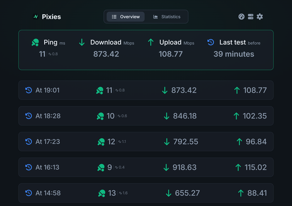
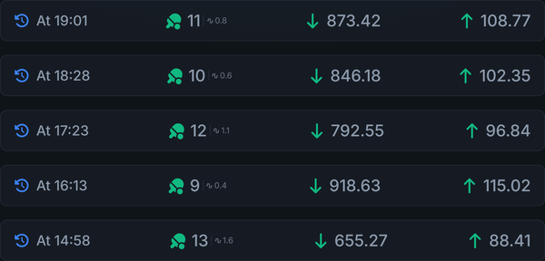
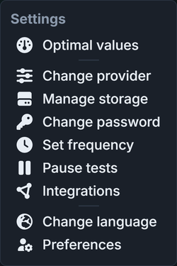
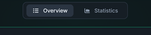

[![License][license-shield]][license-url]
[![Release][release-shield]][release-url]
[![Build][build-shield]][build-url]
[![Container][container-shield]][container-url]
[![Last commit][commit-shield]][commit-url]

<br />

<div align="center">
  <a href="https://github.com/ikhsanddy/pixies">
    
  </a>

  <h1>Pixies</h1>

  <p><strong>Self-hosted internet speed test analytics.</strong></p>

  <p>
    Pixies runs speed tests on your own schedule, keeps the results for as long as you configure,
    and turns them into charts, exports and metrics you can query.
  </p>
</div>

## Table of Contents

- [Features](#features)
- [Screenshots](#screenshots)
- [Quick Start](#quick-start)
- [Configuration](#configuration)
- [Architecture](#architecture)
- [Development](#development)
- [Deployment](#deployment)
- [Contributing](#contributing)
- [License](#license)

## Features

**Measurement**

- Runs Ookla, LibreSpeed or Cloudflare speed tests and records ping, jitter, download and upload.
- Manages multiple speed test servers (nodes) and lets you switch between them from the dashboard.
- Downloads and manages the provider CLIs and server lists itself.

**Analytics**

- Dashboard with a test list and statistics over time for speed, ping and jitter.
- Configurable retention period; expired results are pruned automatically (default: 365 days).
- CSV and JSON export for any date range.

**Automation**

- Cron-based scheduling with an optional start offset, plus manual test runs from the UI.
- Optional test run on server startup.

**Integrations**

- Prometheus metrics (`pixies_*`) for Grafana dashboards and alerting.
- Health check pings for test started, test finished, test failed and minute-passed events.
- Notifications through Discord, Telegram, Gotify, ntfy, Pushover, InfluxDB and generic webhooks.

**Deployment**

- One Bun server that serves the dashboard, the REST API and the Prometheus endpoint.
- SQLite by default, MySQL supported through environment variables.
- Docker image, prebuilt binaries for Linux, macOS and Windows, an MSI installer and an install script.
- Installable dashboard (PWA) available in 13 languages.

## Screenshots

| Dashboard | Test history |
| --- | --- |
|  <br/> *Dashboard* |  <br/> *Test history* |
|  <br/> *Settings* |  <br/> *Statistics switcher* |

## Quick Start

### Prerequisites

- [Bun](https://bun.sh) 1.x (runtime and package manager for both the server and the dashboard build)
- Docker, only if you prefer running the container image

### From source

```sh
git clone https://github.com/ikhsanddy/pixies.git
cd pixies

bun install

# Start the API and the dashboard dev server together
bun run dev
```

`bun run dev` generates the migration and integration indexes, starts the server on port `5216`
(`5217` for HTTPS once certificates exist in `data/certs`) and starts the Vite dev server, which
serves the dashboard on its default port `5173` and proxies `/api` to `5216`.

Production build from source:

```sh
bun run build:binary
./Pixies
```

The binary embeds the dashboard, so it can be copied to any machine with a Bun runtime.

### Docker

```yaml
services:
  pixies:
    image: ghcr.io/ikhsanddy/pixies:latest
    container_name: Pixies
    ports:
      - "5216:5216"
    volumes:
      - pixies:/pixies/data
    restart: unless-stopped

volumes:
  pixies:
```

Then open `http://localhost:5216`. The data volume holds the SQLite database, certificates, logs
and the provider server lists, so keep it when upgrading.

## Configuration

All configuration is read from environment variables at startup.

| Variable | Default | Description |
| --- | --- | --- |
| `SERVER_PORT` | `5216` | HTTP port for the dashboard and API |
| `HTTPS_PORT` | `5217` | HTTPS port, only started when `data/certs/cert.pem` and `key.pem` exist |
| `DB_TYPE` | `sqlite` | Database dialect: `sqlite` or `mysql` |
| `DB_NAME` | – | MySQL database name (required for MySQL) |
| `DB_USER` | – | MySQL user (required for MySQL) |
| `DB_PASS` | – | MySQL password (required for MySQL) |
| `DB_HOST` | `localhost` | MySQL host |
| `RUN_TEST_ON_STARTUP` | `false` | Run one speed test when the server starts |
| `PREVIEW_MODE` | `false` | Serve the instance as a demo (uses `data/storage_preview.db`, disables admin login) |
| `PREVIEW_MESSAGE` | – | Message shown to visitors while preview mode is active |

With the default SQLite setup the database is `data/storage.db` next to the working directory.

## Architecture

```
pixies/
├── client/        React 19 + Vite dashboard (PWA; translations in public/assets/locales)
├── server/        Bun + Express 5 API, Sequelize models, migrations and integrations
├── web/           Marketing landing page (React + Vite)
├── docs/          VitePress documentation (English)
├── scripts/       Installer, uninstaller and code generators
├── Dockerfile     Multi-stage image: dashboard build, server build, runtime
└── package.json   Scripts and server dependencies
```

The server exposes `/api/*` for the dashboard and `/api/prometheus` for scraping. Models,
migrations and integration modules are indexed by generated files
(`server/migrations/index.js`, `server/integrations/index.js`), which is why the generators run
before the server starts.

## Development

| Script | Purpose |
| --- | --- |
| `bun run dev` | Generate indexes, start the API and the dashboard dev server |
| `bun run server` | Start the API in watch mode |
| `bun run client` | Start the dashboard dev server only |
| `bun run build` | Generate indexes and build the dashboard into `client/build` |
| `bun run build:binary` | Build and embed the dashboard, then compile the `Pixies` binary |
| `bun run generate-migrations` | Regenerate `server/migrations/index.js` |
| `bun run generate-integrations` | Regenerate `server/integrations/index.js` |
| `bun run generate-client-embed` | Embed the built dashboard into the server bundle |

Additional apps:

```sh
# Documentation site
cd docs && bun install && bun run dev

# Landing page
cd web && bun install && bun run dev
```

The repository has no automated test suite; verify changes with the builds above and a manual run
of the affected feature.

Launch video and brand assets: [brand/](brand/) — see `brand/launch.mp4` and `brand/brand.md`.

## Deployment

- **Docker** – build the image locally with `docker build -t pixies .`, or use the published
  `ghcr.io/ikhsanddy/pixies` image from the compose file above.
- **Prebuilt binaries** – release assets include `Pixies` for Linux and macOS (x64 and arm64) and
  `Pixies.exe` for Windows, plus `Pixies.zip` for running from source with Bun.
- **Installer script** – `scripts/install.sh` installs to `/opt/pixies`, registers the
  `pixies.service` systemd unit and starts it. `scripts/uninstall.sh` removes the service and the
  container setup, and keeps the data with `--keep-data`.
- **MSI** – Windows installer built from the workflow in `.github/workflows/build-msi.yml`.

## Contributing

- Open an issue for bugs and feature requests: <https://github.com/ikhsanddy/pixies/issues>
- Read [`.github/PULL_REQUEST_TEMPLATE.md`](.github/PULL_REQUEST_TEMPLATE.md) before submitting.
- All locale files in `client/public/assets/locales/` are maintained in this repository and can be
  updated with a pull request.
- Keep pull requests focused and describe how the change was verified.

## License

Released under the MIT license. See [`LICENSE`](LICENSE) for the full text.

[license-shield]: https://img.shields.io/github/license/ikhsanddy/pixies
[license-url]: https://github.com/ikhsanddy/pixies/blob/master/LICENSE
[release-shield]: https://img.shields.io/github/v/release/ikhsanddy/pixies
[release-url]: https://github.com/ikhsanddy/pixies/releases/latest
[build-shield]: https://img.shields.io/github/actions/workflow/status/ikhsanddy/pixies/ci.yml?branch=master
[build-url]: https://github.com/ikhsanddy/pixies/actions/workflows/ci.yml
[container-shield]: https://img.shields.io/badge/ghcr.io-ikhsanddy%2Fpixies-2496ED&logo=docker&logoColor=white
[container-url]: https://github.com/ikhsanddy/pixies/pkgs/container/pixies
[commit-shield]: https://img.shields.io/github/last-commit/ikhsanddy/pixies
[commit-url]: https://github.com/ikhsanddy/pixies/commits/master
